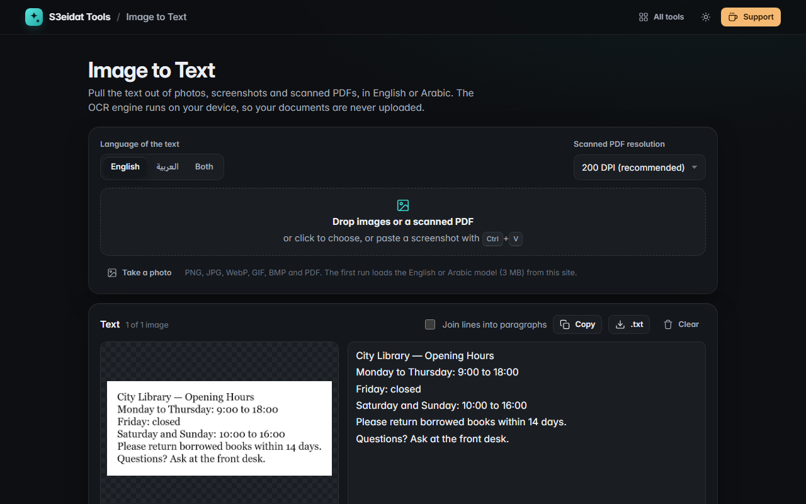

# Image to Text

> Extract text from photos, screenshots and scanned PDFs (OCR), in English or Arabic. Free, private, and it runs entirely in your browser.

### ▶ [Open Image to Text](https://s3eidat.github.io/image-to-text/)



## Features

- **OCR in English, Arabic, or both** on the same page
- **Images** by drop, file picker, phone camera ("Take a photo"), or **paste a screenshot** with Ctrl+V
- **Scanned PDFs**: every page is rendered at 150, 200 or 300 DPI and read one after another
- Live **progress** per page and a **Stop** button
- Result in an editable, **right-to-left aware** text box, with words, characters and **average confidence**
- **Per-page** results for multi-page jobs, each with its own confidence and Copy button
- Optional **join lines into paragraphs** (also rejoins words hyphenated across lines)
- **Copy** or download as **.txt** (UTF-8, opens correctly in Notepad)

OCR quality depends on the image: sharp, straight, well-lit text works best. Handwriting is not supported well.
Very large photos are scaled down to 4200 px on the long side before reading.

## Privacy

Your images and PDFs never leave your device. The OCR engine (WebAssembly) and the English and Arabic
language models are loaded from this site's own `lib/` folder, not from a CDN, and nothing is sent anywhere.
There is no server, no account, no analytics. The page ships with a strict Content-Security-Policy
(`connect-src 'self'`), so the browser itself blocks any attempt to send data elsewhere. The policy adds only
`'wasm-unsafe-eval'`, which lets the browser compile the OCR engine; JavaScript `eval` stays blocked.
Only your settings are remembered in this browser.

## Run it yourself

It's plain HTML, CSS and JavaScript with no build step:

```bash
git clone https://github.com/s3eidat/image-to-text
cd image-to-text
python -m http.server 8000
```

Then open http://localhost:8000.

## Credits

Shipped unmodified in `lib/`:

- [Tesseract.js](https://github.com/naptha/tesseract.js) 5 and tesseract.js-core (the Tesseract OCR engine compiled to WebAssembly), Apache-2.0. See `lib/tesseract.LICENSE`.
- English (`eng`) and Arabic (`ara`) trained models from the [tessdata](https://github.com/tesseract-ocr/tessdata) project, Apache-2.0.
- PDF rendering by [PDF.js](https://mozilla.github.io/pdf.js/) (Mozilla), Apache-2.0. See `lib/pdfjs.LICENSE`.

## Support

If this saved you time, **[buy me a coffee ☕](https://s3eidat.github.io/coffee/)**. It keeps every tool free.

---

Part of **[S3eidat Tools](https://s3eidat.github.io/)**: 100+ free, private tools that run in your browser. MIT licensed.
